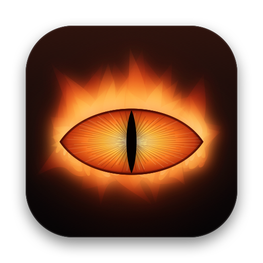

<p align="center"></p>

# Sauron

Widget flotante para macOS que vigila las sesiones de Claude Code abiertas en
VS Code y avisa cuando una **requiere atención** (pide permiso o hace una
pregunta) o cuando **terminó de trabajar**. Un clic lleva a la ventana y a la
pestaña de esa sesión, y los permisos se pueden aprobar desde el propio widget.

## Uso

- **Píldora contraída**: el Ojo (la mirada recorre de lado a lado mientras
  alguna sesión trabaja) y contadores: ● ámbar, requieren atención; ✓ verde, terminaron;
  número naranja, trabajando. El borde toma el color del estado más urgente y
  late mientras alguna sesión espera.
- **Clic** en la píldora: se expande con la lista de sesiones agrupadas por
  carpeta de VS Code. Cada fila muestra el nombre de la sesión, su estado, su
  modo de permisos y hace cuánto cambió.
- **Clic en una sesión**: enfoca su ventana de VS Code y abre su pestaña.
- **Aprobar permisos**: cuando una sesión pide permiso, su tarjeta muestra qué
  pide (el comando, el archivo, la URL) con los botones **Permitir** y
  **Rechazar**. El detalle completo (descripción, contenido, cambios) está en
  el tooltip, y al pasar el puntero se ven más líneas. Permitir vale solo para
  esa vez. El diálogo de VS Code sigue disponible: gana el primero que conteste.
- **Aviso**: cuando una sesión cambia, la fila se asoma unos segundos y suena
  una fanfarria (atención) o un arpa (terminó). Si el puntero está
  encima, no se cierra.
- **Arrastrar** la píldora para moverla. Al soltarla elige la esquina más
  cercana y desde ahí crece hacia el centro de la pantalla.
- **Clic derecho**: el sonido de cada aviso (épicos como fanfarria, cuerno,
  arpa o campanario; sobrios; los del sistema; o ninguno. Al detener el
  puntero sobre uno suena de muestra, y al elegirlo el menú sigue abierto para
  probar otros), asomarse, mostrar inactivas, marcar todo como visto y salir.

Los sonidos son tonos que ya trae macOS (las alertas y los tonos de llamada de
Apple): Sauron no incluye audio. Si alguno no existe en tu versión de macOS,
no aparece en el menú. Sus volúmenes están igualados.

La primera vez que se abre una sesión desde Sauron, VS Code puede pedir
confirmación para que la extensión de Claude Code abra el enlace; conviene
marcar "no volver a preguntar".

### Colores

La franja de cada fila usa el color del modo, tomado del tema oscuro de
Claude Code:

| Modo | Color |
|---|---|
| default | naranja Claude |
| acceptEdits | violeta |
| plan | verde azulado |
| auto, bypassPermissions | rojo |

## Instalación

Requiere macOS 14 o superior y las Command Line Tools (`xcode-select
--install`). No hace falta Xcode.

```bash
./instalar.sh                 # compila, copia a ~/Applications, agrega el hook y arranca al iniciar sesión
./instalar.sh --desinstalar   # lo detiene y borra la app, el LaunchAgent y el hook
./construir.sh                # solo compila: build.noindex/Sauron.app
```

`instalar.sh` agrega un hook `PermissionRequest` a `~/.claude/settings.json`
(la primera vez guarda una copia en `settings.json.antes-de-sauron`) y solo
toca esa entrada. Las sesiones abiertas antes de instalar pueden necesitar
reabrirse para tomarlo.

## Cómo funciona

Para vigilar, Sauron solo lee:

- `~/.claude/sessions/<pid>.json`: Claude Code mantiene ahí el estado de
  cada proceso (`busy`, `waiting`, `idle`), qué espera y su carpeta.
  "Terminó" es una transición `busy → idle` sostenida al menos 1,5 s, tras un
  turno de 2 s o más.
- `~/.claude/projects/.../<sesión>.jsonl`: el título de la sesión
  (`custom-title` o `ai-title`) y el modo de permisos del último mensaje.
- `~/.claude/ide/*.lock`: qué carpetas tiene abiertas cada ventana de VS Code.

Estos archivos son internos de Claude Code y pueden cambiar entre versiones.
Todo su manejo está en `Registro.swift` y `Transcript.swift`. La vigilancia es
por eventos (FSEvents y el fin de cada proceso): en reposo no lee nada.

### Permisos

Claude Code ejecuta el hook `PermissionRequest` a la vez que muestra su
diálogo, y gana el primero que decide. El hook es el propio binario
(`Sauron --hook-permiso`): pasa la petición a Sauron por un socket Unix en
`~/Library/Application Support/Sauron/` (carpeta 0700, socket 0600) y espera
la respuesta.

- Si Sauron no está abierto, la sesión no es de VS Code o algo falla, el hook
  sale sin decidir y queda solo el diálogo normal.
- Si se contesta en VS Code, Sauron suelta la petición en cuanto la sesión
  deja de esperar.
- Cada extremo comprueba que el otro es este mismo ejecutable: otro programa
  no puede hacerse pasar por Sauron para aprobar.

### Limitaciones

- El modo mostrado es el del último mensaje enviado. Si se cambia el modo sin
  enviar nada (por ejemplo, al aprobar un plan), Sauron lo ve recién con el
  siguiente mensaje.
- Solo vigila sesiones de la extensión de VS Code, no las de la terminal.
  Tampoco aprueba sus permisos: el hook sale de inmediato en la terminal.
- Aprobar desde Sauron no ofrece "permitir siempre".

## Diagnóstico

```bash
F=build.noindex/Sauron.app/Contents/MacOS/Sauron
$F --volcar                 # JSON con lo que Sauron interpreta de cada sesión viva
$F --capturas <carpeta>     # renderiza las vistas a PNG con datos de ejemplo
$F --autoprueba <carpeta>   # abre la ventana real, la recorre, la guarda en PNG y sale
$F --icono <carpeta>        # dibuja el icono (Sauron.iconset) y logo.png
$F --sonidos                # lista los tonos y si existen en este Mac
SAURON_CLAUDE_DIR=<dir> $F    # usa otra carpeta en lugar de ~/.claude (pruebas)
python3 pruebas/permisos.py <carpeta temporal> $F   # banco de pruebas del puente de permisos
```

Ejecutado desde una terminal, Sauron imprime una línea por evento detectado.

## Licencia

MIT. Ver `LICENSE`.
